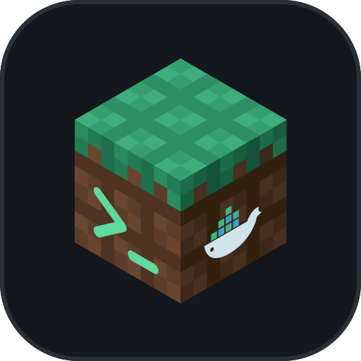
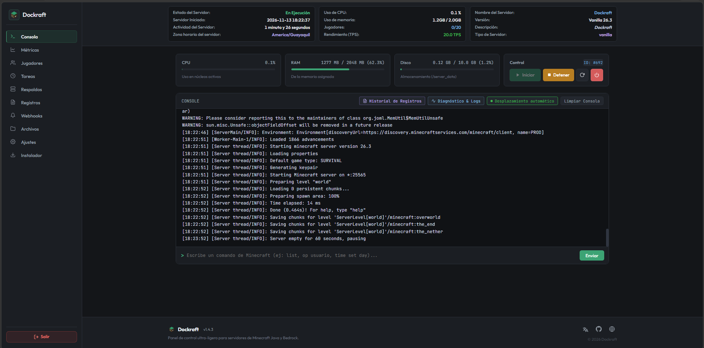
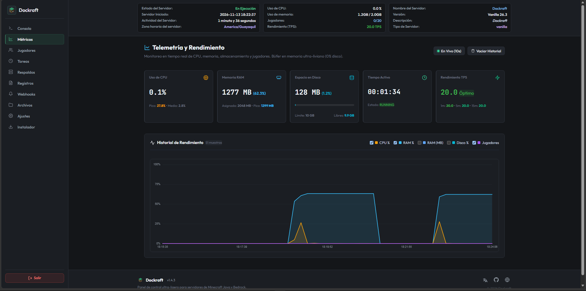

<table>
  <tr>
    <td width="140" align="center" valign="middle">
      
    </td>
    <td valign="middle">
      <h2>🎮 Dockraft — Dedicated Minecraft Server (Docker, Windows & Linux)</h2>
      <p><strong>Panel web ultra-ligero y automatizado para administrar servidores dedicados de Minecraft (Java & Bedrock) en Docker, Windows y Linux AppImage.</strong></p>
      <p>
        <a href="https://hub.docker.com/r/marcusm99/dockraft"></a>
        <a href="https://github.com/GMS-EC/dockraft/releases/latest"></a>
        <a href="LICENSE"></a>
        <a href="https://fastapi.tiangolo.com"></a>
        <a href="https://gmsec.cc"></a>
        <br />
        
      </p>
    </td>
  </tr>
</table>

<p>
  🌐 <strong>Select Language / Selecciona Idioma:</strong> <a href="#-versión-en-español"><strong>ES Español</strong></a> | <a href="#-english-version"><strong>GB English</strong></a>
</p>

<table width="100%">
  <tr>
    <td align="center" width="50%">
      
      <sub><b>Consola interactiva y control en tiempo real</b></sub>
    </td>
    <td align="center" width="50%">
      
      <sub><b>Telemetría de hardware y gráficos de rendimiento (TPS)</b></sub>
    </td>
  </tr>
</table>

---

## 🇪🇸 Versión en Español

### 💡 ¿Por qué Dockraft? (Arquitectura de Instancia Única)

Los paneles tradicionales para Minecraft como **Crafty Controller** o **Pterodactyl** fueron diseñados para alojar decenas de servidores concurrentes. Por esa razón, requieren bases de datos pesadas (MySQL/PostgreSQL), colas de procesos (Redis/Celery), demonios en segundo plano y múltiples servicios que consumen entre **350 MB y más de 1 GB de memoria RAM en reposo**, incluso antes de encender el juego.

**Dockraft fue diseñado bajo una filosofía intencionalmente distinta: 1 Contenedor = 1 Servidor Dedicado.**

Al enfocarse exclusivamente en mantener y optimizar **una única instancia de servidor por contenedor**:

- **No requiere bases de datos externas**: Todas las opciones y configuraciones se gestionan limpiamente en archivos JSON locales.
- **No tiene intermediarios pesados**: El panel corre en un único proceso asíncrono en Python con FastAPI y Uvicorn.
- **Aprovechamiento máximo del hardware**: En un VPS o servidor con 2 GB, 4 GB u 8 GB de memoria, Dockraft consume entre **~50 y 75 MB de RAM** (según el sistema operativo) y **~0 % de CPU en reposo**. En un 2 GB quedan libres más del 96 % de la RAM y en un 8 GB más del 99 %, **todo ese resto disponible para el juego, tus mundos, mods y jugadores.**

---

### 📊 Comparativa de Consumo Real de Memoria RAM (Prueba Empírica)

| Panel de Control  | Consumo en Reposo (Idle) | Tiempo de Arranque  | Enfoque de Servidores                                      |
| :---------------- | :----------------------: | :-----------------: | :--------------------------------------------------------- |
| **Dockraft**      | **~50–75 MB** (~0 % CPU) |   **~1 segundo**    | **Instancia única dedicada (ultra-ligero y optimizado)**   |
| Crafty Controller |     ~350 MB a 700 MB     |  ~20 a 30 segundos  | Multi-servidor pesado (Tornado, Flask, SQLite/Postgres)    |
| Pterodactyl Panel |     ~800 MB a 1.2 GB     | Múltiples servicios | Infraestructura distribuida (PHP, Nginx, DB, Redis, Wings) |

---

### ✨ Características Principales

- 🕹️ **Instalador en 1 Clic**: Elige el tipo de servidor y la versión; Dockraft descarga los binarios oficiales, acepta el EULA automáticamente y configura los puertos y archivos iniciales:
  - **PaperMC**: Rápido y optimizado. El más recomendado para jugar con amigos y usar plugins.
  - **Purpur**: Variante de Paper con máxima personalización y gran rendimiento.
  - **Mojang Vanilla**: El Minecraft clásico original, sin añadidos ni plugins.
  - **Fabric**: Ligero y rápido para jugar con mods modernos.
  - **Minecraft Forge**: El sistema tradicional y con mayor catálogo de mods.
  - **Bedrock Dedicated**: Para jugar desde celulares, consolas (Xbox, PlayStation, Switch) y Windows.
  - **Importar Servidor (.zip)**: Migra cualquier servidor previo subiendo un archivo comprimido.
- 📟 **Consola en Vivo**: Transmisión de registros en tiempo real, envío de comandos con respuesta instantánea, historial con flechas del teclado y botones de comandos frecuentes.
- 💾 **Respaldos Selectivos**: Elige si respaldar todo el servidor o únicamente carpetas clave (como los mundos o los plugins) para ahorrar espacio en disco.
- ⏰ **Tareas Programadas**: Automatiza reinicios periódicos, encendido/apagado o copias de seguridad usando intervalos de tiempo o expresiones Cron.
- 🔔 **Notificaciones Webhooks**: Recibe avisos automáticos en tu canal de **Discord**, grupo de **Telegram** o **Correo Electrónico** cuando el servidor inicie, se detenga o concluya una tarea.
- 📁 **Gestor de Archivos Integrado**: Modifica archivos de texto (`server.properties`, `bukkit.yml`), sube archivos o descomprime paquetes `.zip` directamente desde el navegador.
- 🔒 **Seguridad y Control de Acceso**:
  - Autenticación por contraseña de administrador y sesiones seguras firmadas con HMAC.
  - **Protección contra ataques de fuerza bruta**: Bloqueo temporal automático de 10 minutos tras 5 intentos fallidos de inicio de sesión.

---

### ⚡ Rendimiento y TPS (Ticks Per Second)

El servidor corre en ciclos de **20 TPS** (ticks por segundo). Cada tick procesa IA de mobs, redstone, cultivos e interacciones de jugadores. Si los TPS caen, el juego se siente con lag.

|       TPS       |     Estado      | Experiencia                              |
| :-------------: | :-------------: | :--------------------------------------- |
|    **20.0**     |    🟢 Óptimo    | Sin retrasos.                            |
| **18.0 – 19.9** | 🟡 Carga Ligera | Prácticamente imperceptible.             |
| **15.0 – 17.9** | 🟠 Lag Moderado | Retraso leve en cofres, redstone y mobs. |
|   **< 15.0**    |  🔴 Sobrecarga  | Rubberbanding y bloques que reaparecen.  |

---

### 🖥️ Versiones de Escritorio (Windows y Linux AppImage — Sin Docker)

Además de la versión clásica en contenedor Docker, **Dockraft** cuenta con versiones nativas de escritorio para **Windows (`.exe`)** y **Linux (`.AppImage`)** con soporte bilingüe (**Español `ES` / Inglés `EN`**). En escritorio, la interfaz nativa en segundo plano actúa como el gestor de contenedores (creación, encendido, detención, mapeo de puertos y eliminación de instancias), mientras toda la administración de Minecraft se realiza desde el mismo panel web.

#### 📥 Descarga Directa (GitHub Releases)

En la sección de [**Releases**](https://github.com/GMS-EC/dockraft/releases/latest) encontrarás junto al código fuente (`Source code`):

- **`Dockraft-<version>.exe`**: Ejecutable portable de un solo archivo para Windows (64 bits, sin instalación).
- **`Dockraft-<version>-x86_64.AppImage`**: Ejecutable autocontenido para cualquier distribución Linux (`chmod +x Dockraft-*.AppImage && ./Dockraft-*.AppImage`).

#### 🧰 Qué incluye la edición de Escritorio

- **Icono en la Bandeja del Sistema (`Dockraft`)** con 5 opciones rápidas:
  1. **Instancias**: Abre el Gestor de Instancias con estado en vivo (`● En línea` / `○ Detenida`), botones para **Iniciar y Abrir** (con inicio de sesión e idioma sincronizados automáticamente en el navegador), **Detener** (guardando el mundo limpiamente), **Puertos** (editor en vivo con validación de conflictos), **Archivos** y **Borrar**.
  2. **Nueva instancia**: Asistente para crear servidores adicionales eligiendo nombre, carpeta principal y puertos libres sugeridos automáticamente.
  3. **Editar configuraciones**: Se abre automáticamente en el **primer inicio** para configurar todo desde cero: selector de idioma (`🌐 ES` / `🌐 EN`), carpeta principal, usuario y contraseña global, tiempo de sesión, acceso en red local (`0.0.0.0`), creación en 1 clic de **Acceso directo en Escritorio / Menú Inicio** y apertura asistida de **puertos en el Firewall**.
  4. **Acerca de**: Ventana con los créditos del proyecto, información de la licencia libre **GPLv3** y buscador integrado de actualizaciones contra GitHub Releases y `CHANGELOG.md`.
  5. **Salir**: Cierra el panel ofreciendo guardar y apagar limpiamente todos los servidores de Minecraft activos.
- **Descarga Automática de Java (17, 21 y 25)**: Si tu PC no tiene Java instalado, Dockraft descarga y configura automáticamente el runtime oficial de Eclipse Temurin requerido por la versión de Minecraft que elijas.
- **Todo en una Sola Ubicación (Configuración, Instancias y Backups Protegidos)**:
  ```text
  Carpeta-principal/
  ├── launcher_config.json
  ├── instancias/
  │   └── <nombre-instancia>/
  │       ├── .env
  │       └── data/
  └── backups/
      └── backup-<nombre-instancia>/
  ```
  Toda la configuración global (`launcher_config.json`), las instancias y los respaldos viven dentro de la carpeta principal que designes en la configuración inicial (por defecto `~/Dockraft`). Los respaldos se almacenan fuera de `instancias/` para conservar tus `.zip` si borras una instancia, y si deseas restablecer la aplicación por completo basta con borrar la carpeta principal.

#### 🛠️ Compilar desde el Código Fuente (Windows y Linux)

- **En Windows (PowerShell)**:
  ```powershell
  pip install -r requirements.txt -r packaging/windows/requirements-windows.txt
  powershell -ExecutionPolicy Bypass -File .\packaging\windows\build_windows.ps1
  ```
  _(Genera el ejecutable portable `dist\Dockraft-<version>.exe`)._
- **En Linux (Bash)**:
  ```bash
  pip install -r requirements.txt -r packaging/linux/requirements-linux.txt
  chmod +x packaging/linux/build_appimage.sh packaging/linux/AppRun
  ./packaging/linux/build_appimage.sh
  ```
  _(Genera `dist/Dockraft-<version>-x86_64.AppImage`)._

---

### 🚀 Despliegue con Docker Compose (Recomendado para Servidores/VPS)

#### Opción 1: Copiar y Pegar (Más rápido, sin clonar repositorio)

Crea una carpeta en tu servidor y un archivo `docker-compose.yml` con el siguiente contenido:

```yaml
services:
  dockraft:
    image: marcusm99/dockraft:latest
    container_name: dockraft
    restart: unless-stopped
    ports:
      - "8000:8000" # Panel Web
      - "25565:25565" # Minecraft Java (TCP)
      - "19132:19132/udp" # Minecraft Bedrock (UDP)
    environment:
      - TZ=America/Guayaquil # Zona horaria para respaldos y tareas programadas
      - ADMIN_USER=admin # Usuario del panel web
      - ADMIN_PASSWORD=MiContraseñaSegura # Contraseña obligatoria (si está vacía, genera una aleatoria en logs)
      - SECRET_KEY=genera_una_clave_secreta_con_openssl # Clave HMAC para firmar sesiones (genera con: openssl rand -hex 32)
      - ALLOWED_ORIGINS= # Orígenes CORS permitidos separados por coma (vacío = sin restricción LAN)
      - HTTPS_ENABLED=false # true si usas proxy HTTPS (Nginx/Caddy) para activar cookie Secure
      - TRUST_PROXY_HEADERS=false # true solo detrás de un proxy inverso de confianza
      - TRUSTED_PROXIES=127.0.0.1,::1 # IPs o subredes CIDR del proxy inverso de confianza
      - LOGIN_MAX_ATTEMPTS=5 # Intentos fallidos antes de bloquear la IP
      - LOGIN_COOLDOWN_SECONDS=600 # Segundos de bloqueo tras superar el límite (600 = 10 min)
      - SESSION_TIMEOUT_MINUTES=60 # Minutos de inactividad antes de cerrar sesión
    volumes:
      - ./data:/server_data
      - ./backups:/server_backups
```

Luego inicia el contenedor:

```bash
docker compose up -d
```

#### Opción 2: Clonando el repositorio oficial

1. Clona el repositorio:

   ```bash
   git clone https://github.com/GMS-EC/dockraft.git
   cd dockraft
   ```

2. Configura tus credenciales en un archivo `.env` (recomendado definir `ADMIN_PASSWORD` y `SECRET_KEY`):

   ```bash
   cp .env.example .env
   ```

3. Inicia el servidor:
   ```bash
   docker compose up -d
   ```

El panel estará disponible de inmediato en **`http://localhost:8000`** (o en la IP pública de tu servidor).

---

### 🐳 Despliegue con Docker Run Directo

```bash
docker run -d \
  --name dockraft \
  -p 8000:8000 \
  -p 25565:25565 \
  -p 19132:19132/udp \
  -v ./data:/server_data \
  -v ./backups:/server_backups \
  -e ADMIN_USER=admin \
  -e ADMIN_PASSWORD=MiContraseñaSegura \
  -e TZ=America/Guayaquil \
  --restart unless-stopped \
  marcusm99/dockraft:latest
```

---

### ⚙️ Variables de Entorno

| Variable                 |  Valor por Defecto  | Descripción                                                                                                                                                                                                                |
| :----------------------- | :-----------------: | :------------------------------------------------------------------------------------------------------------------------------------------------------------------------------------------------------------------------- |
| `PORT`                   |       `8000`        | Puerto web de acceso al panel.                                                                                                                                                                                             |
| `ADMIN_USER`             |       `admin`       | Nombre de usuario de inicio de sesión.                                                                                                                                                                                     |
| `ADMIN_PASSWORD`         |     _(efímera)_     | Contraseña del panel (obligatoria). Si se deja vacía, se genera una aleatoria efímera al arrancar y se imprime en los logs.                                                                                                |
| `SECRET_KEY`             |     _(efímera)_     | Clave para firmar sesiones criptográficas HMAC. Si no se define, se guarda en `DOCKRAFT_STATE_DIR` (`/app/.dockraft_state`, fuera de `/server_data`); defínela en `.env` para conservar sesiones al recrear el contenedor. |
| `TZ`                     | `America/Guayaquil` | Zona horaria del servidor para tareas programadas y respaldos.                                                                                                                                                             |
| `LOGIN_MAX_ATTEMPTS`     |         `5`         | Intentos fallidos permitidos antes de aplicar rate limiting.                                                                                                                                                               |
| `LOGIN_COOLDOWN_SECONDS` |        `600`        | Segundos de enfriamiento y bloqueo tras superar el límite de intentos (10 min).                                                                                                                                            |
| `TRUST_PROXY_HEADERS`    |       `false`       | Actívalo (`true`) únicamente cuando Dockraft esté detrás de un proxy inverso de confianza (Nginx, Caddy, Traefik) para leer `X-Forwarded-For` / `X-Forwarded-Proto`.                                                       |
| `TRUSTED_PROXIES`        |   `127.0.0.1,::1`   | Lista separada por comas de IPs o rangos CIDR del proxy inverso de confianza (por ejemplo, la subred bridge de Docker).                                                                                                    |

---

### 📂 Volúmenes Persistentes

- **`/server_data`**: Aloja el servidor activo (mundos, plugins, mods, configuraciones y logs).
- **`/server_backups`**: Carpeta aislada donde se guardan las copias de seguridad `.zip`.

> **Permisos en Linux (`UID/GID 1000`)**: Desde `v1.4.2`, el contenedor se ejecuta como usuario sin privilegios `dockraft` (`1000:1000`). Si actualizas desde una versión anterior o creas carpetas locales previamente, asegura la propiedad antes de iniciar:
>
> ```bash
> chown -R 1000:1000 ./data ./backups
> ```

---

### 🧪 Pruebas Automatizadas

```bash
pytest tests/ -v
```

---

### 📄 Licencia y Autoría

Distribuido bajo la licencia **GNU General Public License v3.0 (GPLv3)**. Consulta el archivo [`LICENSE`](LICENSE) para más detalles.

Desarrollado por **Marcus Mayorga** ([**@GMS-EC**](https://github.com/GMS-EC) • [**gmsec.cc**](https://gmsec.cc)).

---

## 🇬🇧 English Version

### 💡 Why Dockraft? (Single-Instance Dedicated Architecture)

Traditional Minecraft control panels like **Crafty Controller** or **Pterodactyl** were architected to host dozens of game servers simultaneously. Because of this, they bundle heavy relational databases (MySQL/PostgreSQL), background worker queues (Redis/Celery), and multiple background daemons that consume between **350 MB and over 1 GB of idle RAM** before any game is even started.

**Dockraft was purposefully built under a different philosophy: 1 Container = 1 Dedicated Server.**

By focusing strictly on managing and optimizing **a single server instance per container**:

- **No external databases required**: All settings and state are stored cleanly in lightweight local JSON files.
- **No bloated middleware**: Runs as a single asynchronous Python process powered by FastAPI and Uvicorn.
- **Maximum hardware efficiency**: On a 2 GB, 4 GB, or 8 GB VPS, Dockraft consumes about **50–75 MB of RAM** (OS-dependent) and **~0% CPU at idle**. That leaves over 96% free on a 2 GB box and over 99% on 8 GB, **all of it available to Minecraft, your worlds, mods, and players.**

---

### 📊 Real RAM Consumption Benchmark

| Panel             |     Idle RAM Usage      |   Startup Time    | Multi-server Model                                           |
| :---------------- | :---------------------: | :---------------: | :----------------------------------------------------------- |
| **Dockraft**      | **~50–75 MB** (~0% CPU) |   **~1 second**   | **Single dedicated instance (ultra-lightweight & focused)**  |
| Crafty Controller |    ~350 MB to 700 MB    | ~20 to 30 seconds | Heavy multi-instance stack (Tornado, Flask, SQLite/Postgres) |
| Pterodactyl Panel |    ~800 MB to 1.2 GB    | Multiple services | Distributed infrastructure (PHP, Nginx, DB, Redis, Wings)    |

---

### ✨ Key Features

- 🕹️ **1-Click Server Installer**: Select your desired engine and Minecraft version; Dockraft downloads official builds, automatically accepts the Mojang EULA, and generates initial configuration files:
  - **PaperMC**: Fast and optimized. The top choice for playing with friends and plugins.
  - **Purpur**: Enhanced Paper fork with high performance and deep gameplay customization.
  - **Mojang Vanilla**: Pure, unmodified official Minecraft server.
  - **Fabric**: Lightweight and fast for modern modpacks.
  - **Minecraft Forge**: The classic, battle-tested modding ecosystem.
  - **Bedrock Dedicated**: For mobile devices, consoles (Xbox, PlayStation, Switch), and Windows.
  - **Import Server (.zip)**: Easily migrate any existing server by uploading a `.zip` archive.
- 📟 **Live Web Console**: Real-time log streaming, instant command input, keyboard arrow command history, and quick-action buttons.
- 💾 **Selective Backups**: Choose whether to back up the entire server or just crucial directories (such as worlds or plugins) to save storage space.
- ⏰ **Automated Scheduled Tasks**: Schedule automated restarts, power on/off times, or recurring backups using custom intervals or Cron expressions.
- 🔔 **Webhook Alerts**: Receive automatic notifications in your **Discord** channel, **Telegram** group, or **Email** when the server starts, stops, or finishes a scheduled task.
- 📁 **Built-in Web File Manager**: Browse server directories, edit configuration files (`server.properties`, `bukkit.yml`) right in your browser, upload files, or extract `.zip` archives safely.
- 🔒 **Security & Access Control**:
  - Password authentication with tamper-proof HMAC session cookies.
  - **Brute-force protection**: Automatic 10-minute cooldown lockout after 5 consecutive failed login attempts.

---

### ⚡ Performance & TPS (Ticks Per Second)

The server runs at **20 TPS** (ticks per second). Each tick processes mob AI, redstone, crop growth, and player interactions. Dropping below 20 TPS causes in-game lag.

|       TPS       |     Status      | Experience                                   |
| :-------------: | :-------------: | :------------------------------------------- |
|    **20.0**     |   🟢 Optimal    | No delays.                                   |
| **18.0 – 19.9** |  🟡 Light Load  | Virtually imperceptible.                     |
| **15.0 – 17.9** | 🟠 Moderate Lag | Slight delays on chests, redstone, and mobs. |
|   **< 15.0**    |  🔴 Overloaded  | Rubberbanding and blocks reappearing.        |

---

### 🖥️ Native Desktop Editions (Windows & Linux AppImage — No Docker Required)

Alongside the classic Docker container, **Dockraft** provides native desktop builds for **Windows (`.exe`)** and **Linux (`.AppImage`)** with full bilingual support (**Spanish `ES` / English `EN`**). On desktop, the lightweight system-tray app and Tkinter windows act as your local container manager (creating, starting, stopping, port-mapping, and deleting instances), while all Minecraft administration happens inside the same web panel.

#### 📥 Direct Downloads (GitHub Releases)

Available on the [**Releases**](https://github.com/GMS-EC/dockraft/releases/latest) page alongside the source code archives:

- **`Dockraft-<version>.exe`**: Portable single-file executable for Windows x64 (no installation required).
- **`Dockraft-<version>-x86_64.AppImage`**: Self-contained Linux x86_64 AppImage (`chmod +x Dockraft-*.AppImage && ./Dockraft-*.AppImage`).

#### 🧰 Desktop Features

- **System Tray Icon (`Dockraft`)** with 5 actions (dynamically localized in `ES` / `EN`):
  1. **Instances (`Instancias`)**: View all instances with live status (`● Online` / `○ Stopped`), 1-click **Open Web** with automatic login & language auto-fill, **Stop** (gracefully saves the Minecraft world and stops the instance), **Ports** (live-validated port editor), **Files**, and **Delete** (with confirmation).
  2. **New instance (`Nueva instancia`)**: Wizard to create additional server instances with automatic free-port suggestions.
  3. **Edit settings (`Editar configuraciones`)**: Automatically opens on **first launch** so you can configure everything upfront: language switcher (`🌐 ES` / `🌐 EN`), main folder, global credentials, session timeout, LAN toggle (`0.0.0.0`), 1-click **Desktop / Start Menu shortcut creator**, and **Firewall port helper**.
  4. **About (`Acerca de`)**: Project credits, **GPLv3** license details, and integrated update checker against GitHub Releases and `CHANGELOG.md`.
  5. **Quit (`Salir`)**: Gracefully saves and stops active Minecraft servers before exiting.
- **Automatic Java Provisioning (Java 17, 21 & 25)**: Automatically downloads the required Eclipse Temurin JRE on demand if Java is not installed on the host.
- **Unified Single-Folder Hierarchy (Config, Instances & Protected Backups)**:
  ```text
  Main-Folder/
  ├── launcher_config.json
  ├── instancias/
  │   └── <instance-name>/
  │       ├── .env
  │       └── data/
  └── backups/
      └── backup-<instance-name>/
  ```
  Global settings (`launcher_config.json`), server instances, and backups all live inside the single main folder you choose during initial configuration (`~/Dockraft` by default). Backups live outside `instancias/` so deleting an instance never deletes its backups, and deleting the main folder cleanly resets the entire app.

#### 🛠️ Building from Source (Windows & Linux)

- **Windows (PowerShell)**:
  ```powershell
  pip install -r requirements.txt -r packaging/windows/requirements-windows.txt
  powershell -ExecutionPolicy Bypass -File .\packaging\windows\build_windows.ps1
  ```
- **Linux (Bash)**:
  ```bash
  pip install -r requirements.txt -r packaging/linux/requirements-linux.txt
  chmod +x packaging/linux/build_appimage.sh packaging/linux/AppRun
  ./packaging/linux/build_appimage.sh
  ```

---

### 🚀 Quick Start with Docker Compose (Recommended for VPS/Servers)

#### Option 1: Copy & Paste (Fastest, no git clone needed)

Create a new directory and save the following as `docker-compose.yml`:

```yaml
services:
  dockraft:
    image: marcusm99/dockraft:latest
    container_name: dockraft
    restart: unless-stopped
    ports:
      - "8000:8000" # Web Panel
      - "25565:25565" # Minecraft Java (TCP)
      - "19132:19132/udp" # Minecraft Bedrock (UDP)
    environment:
      - TZ=America/Guayaquil # Timezone for backups and scheduled tasks
      - ADMIN_USER=admin # Web panel administrator username
      - ADMIN_PASSWORD=MySecurePassword # Mandatory password (if empty, a random one is printed in startup logs)
      - SECRET_KEY=generate_a_secret_key_with_openssl # HMAC key for session signing (generate with: openssl rand -hex 32)
      - ALLOWED_ORIGINS= # Comma-separated allowed CORS origins (empty = unrestricted for LAN)
      - HTTPS_ENABLED=false # Set to true behind an HTTPS reverse proxy (Nginx/Caddy) for Secure cookies
      - TRUST_PROXY_HEADERS=false # Set to true only behind a trusted reverse proxy
      - TRUSTED_PROXIES=127.0.0.1,::1 # Trusted reverse proxy IPs or CIDR subnets
      - LOGIN_MAX_ATTEMPTS=5 # Failed login attempts allowed before IP cooldown
      - LOGIN_COOLDOWN_SECONDS=600 # Lockout duration in seconds after max attempts (600 = 10 min)
      - SESSION_TIMEOUT_MINUTES=60 # Minutes of inactivity before session expires
    volumes:
      - ./data:/server_data
      - ./backups:/server_backups
```

Then launch the container:

```bash
docker compose up -d
```

#### Option 2: Clone the Repository

1. Clone the repository:

   ```bash
   git clone https://github.com/GMS-EC/dockraft.git
   cd dockraft
   ```

2. Configure your environment variables (recommended to set `ADMIN_PASSWORD` and `SECRET_KEY`):

   ```bash
   cp .env.example .env
   ```

3. Launch Dockraft:
   ```bash
   docker compose up -d
   ```

Open your browser at **`http://localhost:8000`** (or your server's public IP).

---

### 🐳 Run Directly with Docker

```bash
docker run -d \
  --name dockraft \
  -p 8000:8000 \
  -p 25565:25565 \
  -p 19132:19132/udp \
  -v ./data:/server_data \
  -v ./backups:/server_backups \
  -e ADMIN_USER=admin \
  -e ADMIN_PASSWORD=MySecurePassword \
  -e TZ=America/Guayaquil \
  --restart unless-stopped \
  marcusm99/dockraft:latest
```

---

### ⚙️ Environment Variables

| Variable                 |    Default Value    | Description                                                                                                                                                                                                    |
| :----------------------- | :-----------------: | :------------------------------------------------------------------------------------------------------------------------------------------------------------------------------------------------------------- |
| `PORT`                   |       `8000`        | Web panel port.                                                                                                                                                                                                |
| `ADMIN_USER`             |       `admin`       | Administrator username for login.                                                                                                                                                                              |
| `ADMIN_PASSWORD`         |    _(ephemeral)_    | Web panel password (mandatory). If left empty, a random ephemeral password is generated on startup and printed to the container logs.                                                                          |
| `SECRET_KEY`             |    _(ephemeral)_    | Cryptographic key used to sign HMAC session tokens. Stored in `DOCKRAFT_STATE_DIR` (`/app/.dockraft_state`, outside `/server_data`) when unset; define it in `.env` so sessions survive container recreations. |
| `TZ`                     | `America/Guayaquil` | Server timezone for scheduled tasks and backup timestamps.                                                                                                                                                     |
| `LOGIN_MAX_ATTEMPTS`     |         `5`         | Maximum failed login attempts allowed before IP cooldown.                                                                                                                                                      |
| `LOGIN_COOLDOWN_SECONDS` |        `600`        | Duration of lockout in seconds (10 minutes).                                                                                                                                                                   |
| `TRUST_PROXY_HEADERS`    |       `false`       | Set to `true` only when Dockraft sits behind a trusted reverse proxy (Nginx, Caddy, Traefik) to honor `X-Forwarded-For` / `X-Forwarded-Proto`.                                                                 |
| `TRUSTED_PROXIES`        |   `127.0.0.1,::1`   | Comma-separated list of trusted reverse proxy IPs or CIDR ranges (e.g., your Docker bridge subnet).                                                                                                            |

---

### 📂 Storage Volumes

- **`/server_data`**: Holds the active Minecraft server (worlds, plugins, mods, configs, and logs).
- **`/server_backups`**: Isolated directory storing compressed `.zip` backup archives.

> **Linux Volume Permissions (`UID/GID 1000`)**: Since `v1.4.2`, the container runs as the non-root `dockraft` user (`1000:1000`). When upgrading from earlier versions or pre-creating bind-mount folders, ensure host ownership matches before starting:
>
> ```bash
> chown -R 1000:1000 ./data ./backups
> ```

---

### 🧪 Automated Testing

```bash
pytest tests/ -v
```

---

## 📄 License & Authorship

Distributed under the **GNU General Public License v3.0 (GPLv3)**. See [`LICENSE`](LICENSE) for details.

Developed by **Marcus Mayorga** ([**@GMS-EC**](https://github.com/GMS-EC) • [**gmsec.cc**](https://gmsec.cc)).
